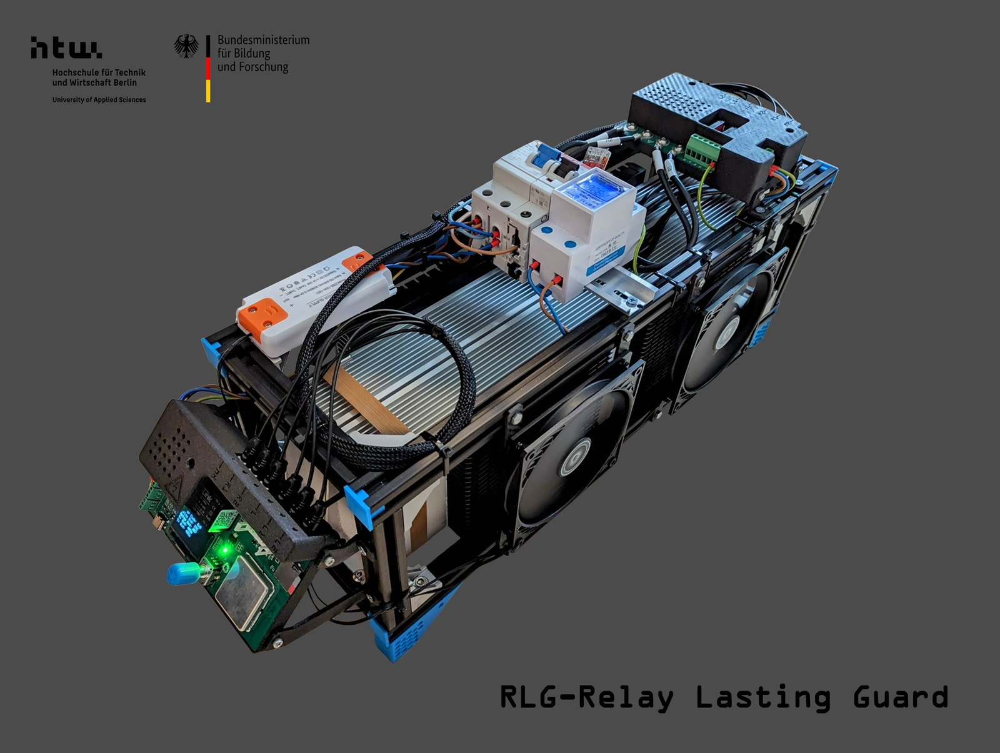
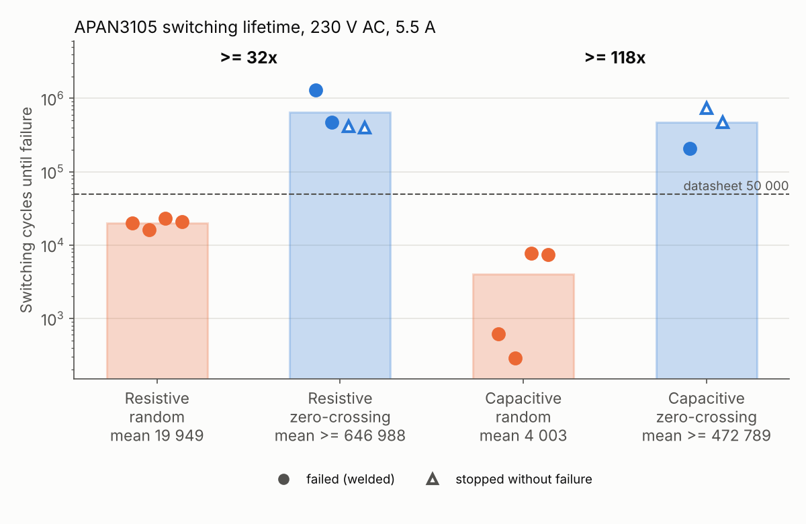
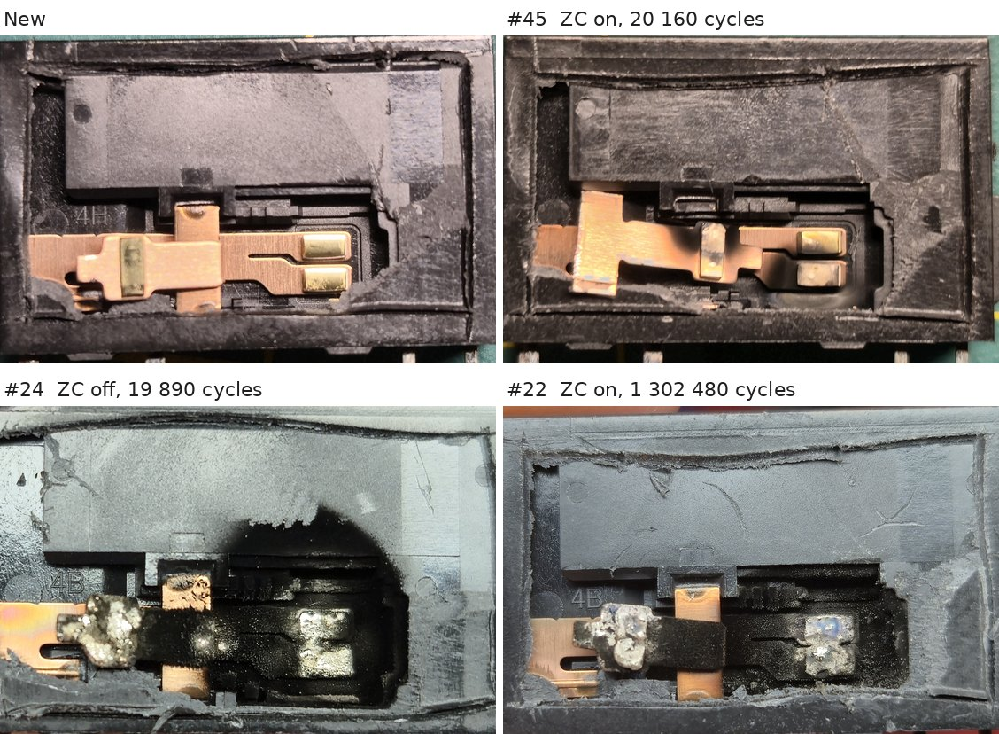
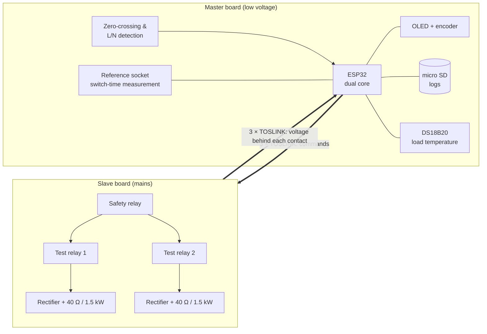
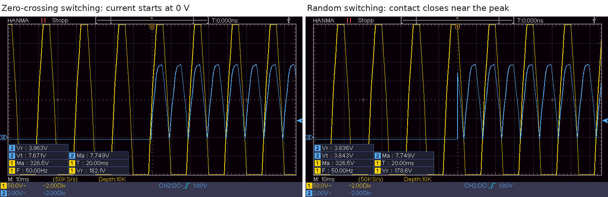

# RLG – Relay Lasting Guard

[](LICENSING.md)

**Automated test bench that switches mechanical relays until they fail, built to measure how much zero-crossing switching extends their life under AC load.**



Mechanical relays in smart plugs, power strips and appliances usually switch at a random point of the mains sine wave. The resulting arc erodes the contacts until they weld. This project measures what happens when the contacts are instead closed and opened at the zero crossing of the mains voltage. The bench runs two relays in parallel for weeks, detects welded contacts automatically and logs every test to an SD card.

It was developed by **Marvin Ramm** as part of his Bachelor's thesis *"Optimising the switching lifetime of mechanical relays through zero-crossing switching under AC loads"* (Microsystems Engineering, HTW Berlin, 2026).

## Key results

Panasonic APAN3105 (5 A / 250 V AC), 230 V mains, 3–4 relays per group:

| Load | Random switching | Zero-crossing switching | Lifetime gain |
|---|---:|---:|---:|
| Resistive, 40 Ω (5.5 A RMS) | 19 949 cycles | ≥ 646 988 cycles | **≥ 32×** |
| Capacitive (rectifier + 150 µF / 400 V electrolytics, high inrush) | 4 003 cycles | ≥ 472 789 cycles | **≥ 118×** |



- Without zero-crossing switching, **every** relay failed below the datasheet rating of 50 000 cycles. With it, every relay exceeded the rating at least four times. The best one reached **1 302 480 cycles**.
- The contact resistance in the resistive case rose by only ~2.3 mΩ with zero-crossing switching, compared with 11.8 mΩ without it, even though the protected relays ran over 30× more cycles.
- A second relay model (Songle SRD-05VDC-SL-C) shows the same effect.
- The values are lower bounds: four protected relays were stopped without failing.

The two halves of the picture below were taken after the **same number of cycles** (≈ 20 000):



More results, including microscope images, profilometry and oscilloscope captures, are in [docs/results.md](docs/results.md).

## How it works



1. **Switch-time measurement.** Before each test, the relay goes into a reference socket on the master board. The firmware averages 20 operate and release cycles. Across 20 specimens the operate time varied by only 3.2 % (mean 4.73 ms), so one calibrated value per relay model is enough.
2. **Zero-crossing control.** An optocoupler marks every zero crossing. The firmware waits for the reference edge, then delays the coil command so that the contact *moves* exactly at the next zero crossing. The correction constants of the detection chain were calibrated with an oscilloscope.
3. **Failure detection.** After every ON and OFF command, the firmware checks the voltage *behind* the contact via its own detector. It looks for a plausible 40–70 Hz signal rather than a static level, which makes the check immune to noise. A welded contact still carries voltage after the coil is released. After 40 confirmed events the relay is retired and its log is finalised.
4. **Galvanic isolation over light.** The first revision used a single board. EMI from the switching relays destroyed the ESP32 several times, with spikes of −3 V to +10 V on the 3.3 V rail. Revision 2 splits control and load onto two boards connected **only by six TOSLINK fibres** and has run without EMI-related failures since.



*Yellow: mains voltage. Blue: load current. With zero-crossing switching, the current starts at 0 V (left). With random switching, the contact closes near the voltage peak (right).*

## Repository layout

```
firmware/            RLG OS – ESP32 firmware (Arduino / PlatformIO)
examples/            Minimal zero-crossing implementation for your own projects
hardware/master/     Control board: schematic, Gerber, BOM, pick & place
hardware/slave/      Mains / load board: schematic, Gerber, BOM, pick & place
data/results.csv     All tested relays (cycles, contact resistance, switch times)
data/logs/           Raw SD card logs of the test runs
data/scripts/        Analysis script that reproduces the figures
docs/                Hardware, firmware and method documentation
```

## Use the method in your own device

You don't need the test bench to use zero-crossing switching. An AC-input optocoupler, three resistors and a few lines of code are enough. See [docs/zero-crossing.md](docs/zero-crossing.md) and the ready-to-flash example in [examples/zero_cross_minimal](examples/zero_cross_minimal/zero_cross_minimal.ino).

## Build the firmware

```bash
cd firmware
pio run -t upload        # PlatformIO, libraries are installed automatically
pio device monitor       # serial menu at 115200 baud
```

Or open `firmware/RLG_OS/RLG_OS.ino` in the Arduino IDE (board: *ESP32 Dev Module*, core 2.0.17) and install the libraries listed in `firmware/platformio.ini`.

**Prebuilt binaries** are attached to every [release](../../releases):

- `RLG_OS_vX.Y.Z_full.bin` – complete image for an empty board:
  `esptool.py --chip esp32 write_flash 0x0 RLG_OS_vX.Y.Z_full.bin`
- `RLG_OS_vX.Y.Z.bin` – application only: copy to the SD card as `/firmware.bin` (updated on next boot), or flash to `0x10000`. Operation, the serial menu, error codes and the log format are described in [docs/firmware.md](docs/firmware.md).

## ⚠️ Safety

This device switches **230 V mains** with up to 5.5 A per channel and drives 1.5 kW load resistors. Only build or operate it if you are qualified to work with mains voltage. Use an RCD and a circuit breaker, never touch an open board while it is connected, and use an isolation transformer for measurements. The design files come without any warranty.

## Limitations

- Each group has 3–4 specimens, and four protected relays were stopped before failing. The factors are orders of magnitude, not precise reliability figures.
- Only resistive and rectifier–capacitive loads were tested. Inductive loads, where the current and voltage zero crossings differ, are an open topic.
- Welding is the only failure criterion detected automatically. Contact resistance is measured manually before and after each test.

## Acknowledgements

The first test system was funded in 2024 by the **IDiA Kickstart programme of HTW Berlin**, supported by the German Federal Ministry of Education and Research (BMBF).

## License

© 2024–2026 Marvin Ramm. Licensed under [CC BY-NC-SA 4.0](LICENSE).

- **Free** for private, educational and research use, including modifications.
- **Attribution is required:** credit Marvin Ramm and link to this repository.
- **Commercial use only with a written agreement** (commercial license / revenue share). Contact: marvin@ramm-eng.de.

Details and the exact attribution text are in [LICENSING.md](LICENSING.md).
