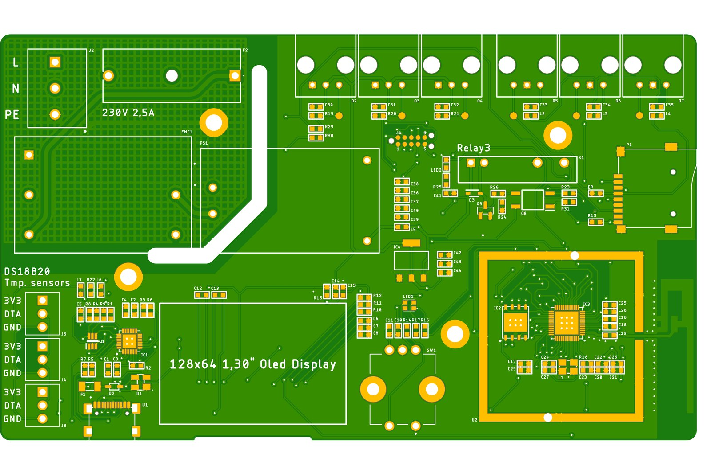
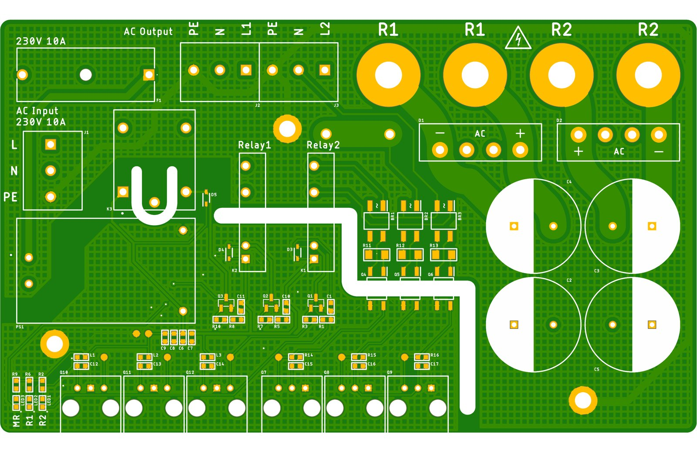

# Hardware

Two 2-layer PCBs (FR4, 1.6 mm, 35 µm copper, ENIG) designed in Fusion Electronics, mounted with the rest of the bench in an aluminium profile frame. Manufacturing files are in [`hardware/`](../hardware).

| Folder | Content |
|---|---|
| `schematic_*.pdf` | schematic |
| `RLG_*_gerber.zip` | Gerber RS-274X + drill file |
| `bom.csv` | bill of materials |
| `pick_and_place.csv` | component positions (mm, top / bottom) |

The BOM is exported from the design tool. Check it against the schematic before ordering.

## Master board – control

- **ESP32-D0WDQ6** with external flash, CP2102N USB-UART and auto-reset, plus a Tag-Connect TC2050 programming header. An RF shield can is soldered over the MCU.
- **Power:** mains → 2.5 A fuse → EMC filter → HLK-PM01 (5 V) → AMS1117 LDO (3.3 V). A linear regulator was chosen on purpose: it adds no switching noise.
- **Zero-crossing detection:** MB10F bridge → TLP185 optocoupler → pull-up. A second identical circuit between L and PE detects reversed polarity. Fuses and relays are single-pole, so swapped L/N would leave the load live.
- **Reference socket** (PA1A-PS) with a contact sense line for measuring operate and release times.
- **3 × TOSLINK TX** (commands) and **3 × TOSLINK RX** (voltage feedback). TOSLINK receivers expect a data stream, so static levels are sent as PWM with ~100 % / ~0 % duty cycle.
- 1.3" SH1106 OLED, rotary encoder, RGB status LED, micro-SD with card detect, three DS18B20 inputs.

## Slave board – mains and load

- **Safety relay** (SRD-05VDC-SL-C): the load is powered only while a test runs and after the safety test passed. It can disconnect the load if a test relay welds.
- **2 test sockets** (PA1A-PS) for tool-free specimen exchange.
- **Relay drivers:** SI2302 MOSFET, gate pull-down (relay stays off with a floating input), flyback diode, indicator LED, buffer capacitor.
- **Load circuit per channel:** KBU810 bridge rectifier (8 A, 300 A surge), optional 150 µF / 400 V capacitors, external 40 Ω / 1.5 kW braking resistor with heatsink and fan.
- **3 voltage detectors** (behind the safety relay and behind each test relay) → TOSLINK back to the master.
- Own HLK-PM01 supply for coils and receivers, 10 A fuse on board.

## Layout and safety

- Mains and low-voltage areas are strictly separated. No low-voltage trace runs under a mains part.
- Clearances follow **IPC-2221**: ≥ 2.5 mm for 301–500 V peak (325 V), external, uncoated.
- **Slots** at the transitions (power module, optocouplers) extend the creepage distance.
- Load trace width per IPC-2221 for 5.75 A and 20 K temperature rise: ≥ 2.2 mm. Traces are wider than that, with exposed copper that can be reinforced with solder.
- Protection chain: RCD → 16 A breaker (load) → board fuses (2.5 A master, 10 A slave).

## Rest of the bench

- Aluminium profile frame, designed completely in Fusion 360 before cutting.
- 2 × braking resistor SXLG 40 Ω / 1.5 kW on heatsinks with 4 fans. A constant temperature keeps the load current constant.
- DIN-rail RCD, breaker and current meter.
- 3D-printed housings for both boards.
