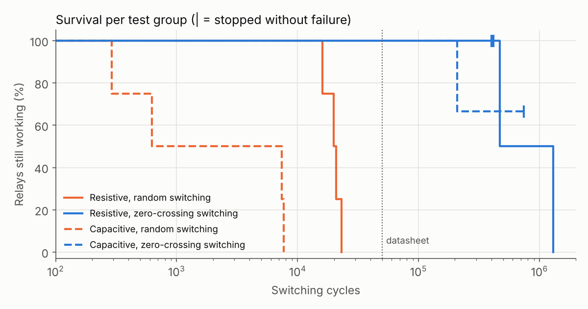
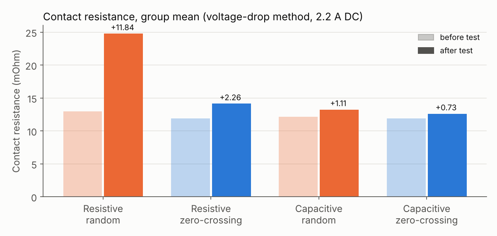
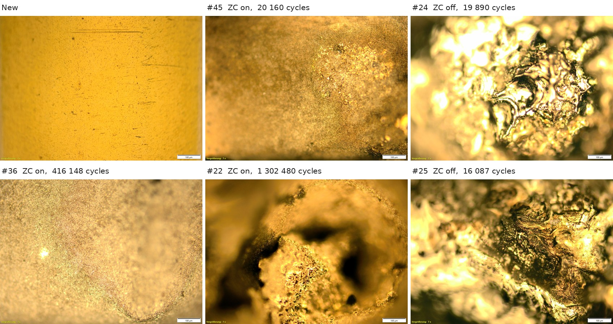
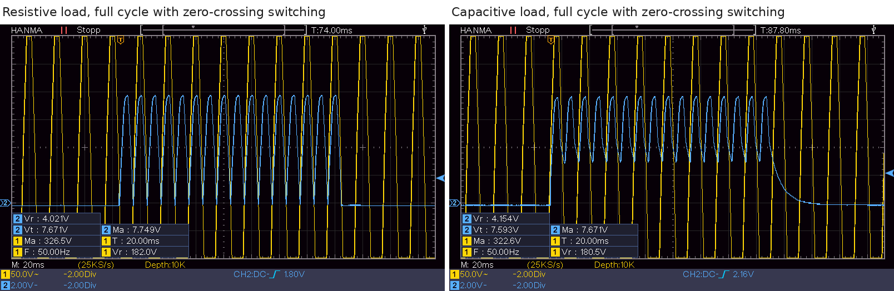
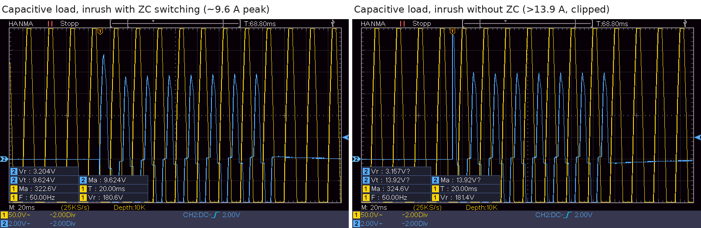
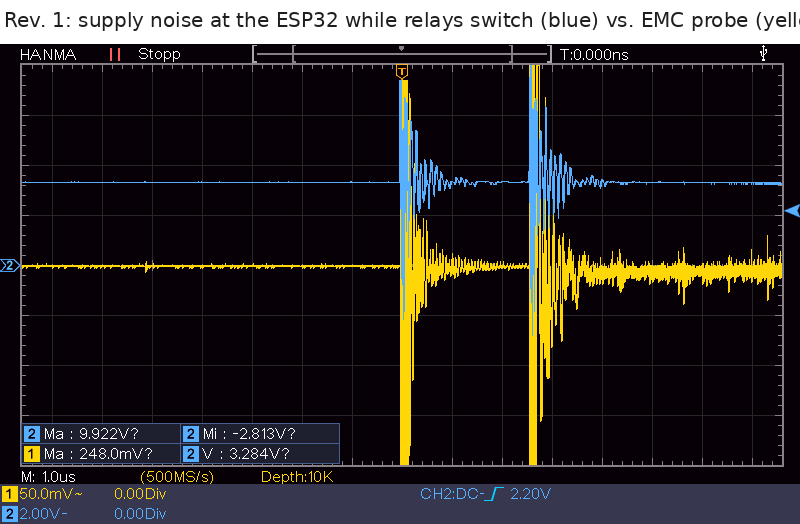

# Results

All numbers below come from [`data/results.csv`](../data/results.csv) and can be reproduced with
[`data/scripts/analyze.py`](../data/scripts/analyze.py). Only runs with firmware 1.1.4 or later are included
(relays #22–#45). Earlier runs used different test timing and are listed in the CSV for completeness only.

## Test conditions

| | |
|---|---|
| Specimen | Panasonic APAN3105 (PA-N, 1 Form A, 5 A / 250 V AC, AgNi + Au contacts) |
| Reference model | Songle SRD-05VDC-SL-C |
| Mains | 230 V / 50 Hz, RCD + 16 A breaker |
| Resistive load | 40 Ω / 1.5 kW braking resistor behind a KBU810 bridge rectifier, measured 5.48 A RMS |
| Capacitive load | same, plus 150 µF / 400 V electrolytic capacitors behind the rectifier (high inrush, simulates an SMPS input stage) |
| Cycle | random 800–820 ms cooldown, 80 ms ON |
| Failure criterion | contact welding, 40 confirmed events |
| Throughput | ≈ 38 000–40 000 cycles per relay and day |

## Lifetime

| Group | n | Mean cycles | Mean abs. deviation | Stopped without failure |
|---|---:|---:|---:|---:|
| Resistive, random | 4 | 19 949 | 9.8 % | 0 |
| Resistive, zero-crossing | 4 | ≥ 646 988 | 50.7 % | 2 |
| Capacitive, random | 4 | 4 003 | 88.6 % | 0 |
| Capacitive, zero-crossing | 3 | ≥ 472 789 | 37.6 % | 2 |

- Without protection, the first welding events appear early and become frequent towards the end of life. Under capacitive load, all relays register several events within the first few hundred cycles because of the inrush current.
- With protection, the four relays that were stopped without failure registered **no** welding event at all, over up to 739 501 cycles.

| SRD-05VDC-SL-C | Cycles |
|---|---:|
| Random switching (#30, #37) | 17 275 / 132 981 |
| Zero-crossing switching (#31) | ≥ 406 339 (stopped) |

## Contact resistance

Measured before and after each test with the voltage-drop method: 2.2 A DC, voltage taken directly at the relay pins, < ±1 % uncertainty.

The SRD-05VDC-SL-C shows the effect even more clearly: without protection, its contact resistance rose from 20 mΩ to 192 mΩ and from 10 mΩ to 235 mΩ. With protection it stayed at 9.7 → 9.9 mΩ after 400 000 cycles.

## Switch times

| | Mean | Mean abs. deviation |
|---|---:|---:|
| Operate time, start of test | 4 732 µs | 3.2 % |
| Operate time, end of test | 4 716 µs | 4.7 % |
| Release time, start of test | 4 497 µs | 7.4 % |
| Release time, end of test | 5 041 µs | 24.9 % |

The operate time is stable across specimens and over the lifetime, so one calibration value per relay model is enough. The release time drifts with wear, so the switch-off point becomes less accurate towards the end of life. Adaptive tracking of the release time is the obvious next improvement.

## Contact surfaces

Contacts were removed, cleaned in an ultrasonic isopropanol bath and inspected under a microscope and with a stylus profilometer (Bruker DektakXT).

Maximum height difference along the profilometer track:

| Relay | Zero-crossing | Cycles | Single contact | Double contact 1 | Double contact 2 |
|---|---|---:|---:|---:|---:|
| New | – | 0 | 5.6 µm | 8.0 µm | 12.5 µm |
| #25 | off | 16 087 | 64.1 µm | 164.9 µm | 35.8 µm |
| #24 | off | 19 890 | 183.6 µm | 72.2 µm | 74.3 µm |
| #45 | on | 20 160 | 8.6 µm | 9.5 µm | 7.4 µm |
| #36 | on | 416 148 | 57.4 µm | 19.9 µm | 94.1 µm |

At the same cycle count (~20 000), the protected contact is indistinguishable from a new one. The unprotected contacts already show craters and material transfer of up to 184 µm.

## Oscilloscope verification

With zero-crossing switching, the inrush of the capacitive load stays at about 9.6 A. Without it, the peak exceeds the scope's range of 13.9 A.

## Lessons from revision 1

On the first single-board revision, EMI from the switching relays coupled into the 3.3 V rail of the ESP32 (spikes from −3 V to +10 V) and destroyed it repeatedly. This led to revision 2, which completely separates the boards and connects them by TOSLINK fibres only.
